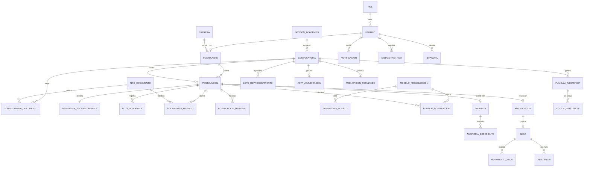
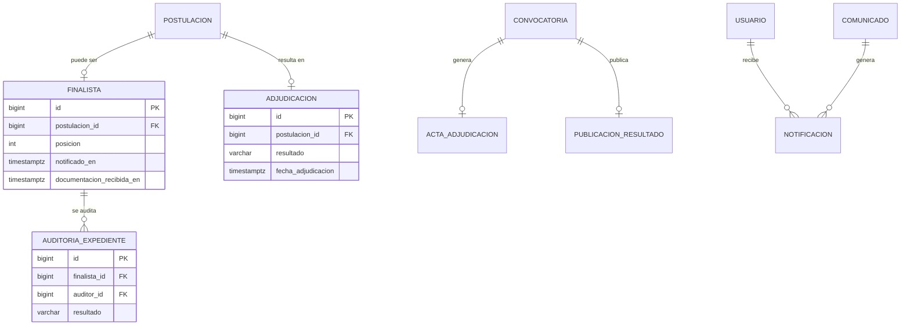
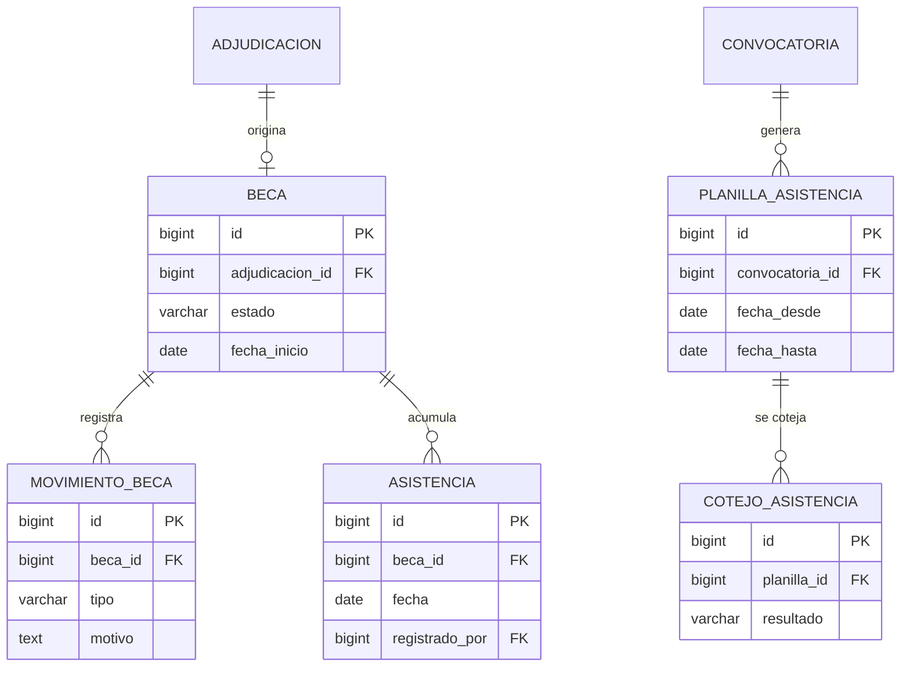
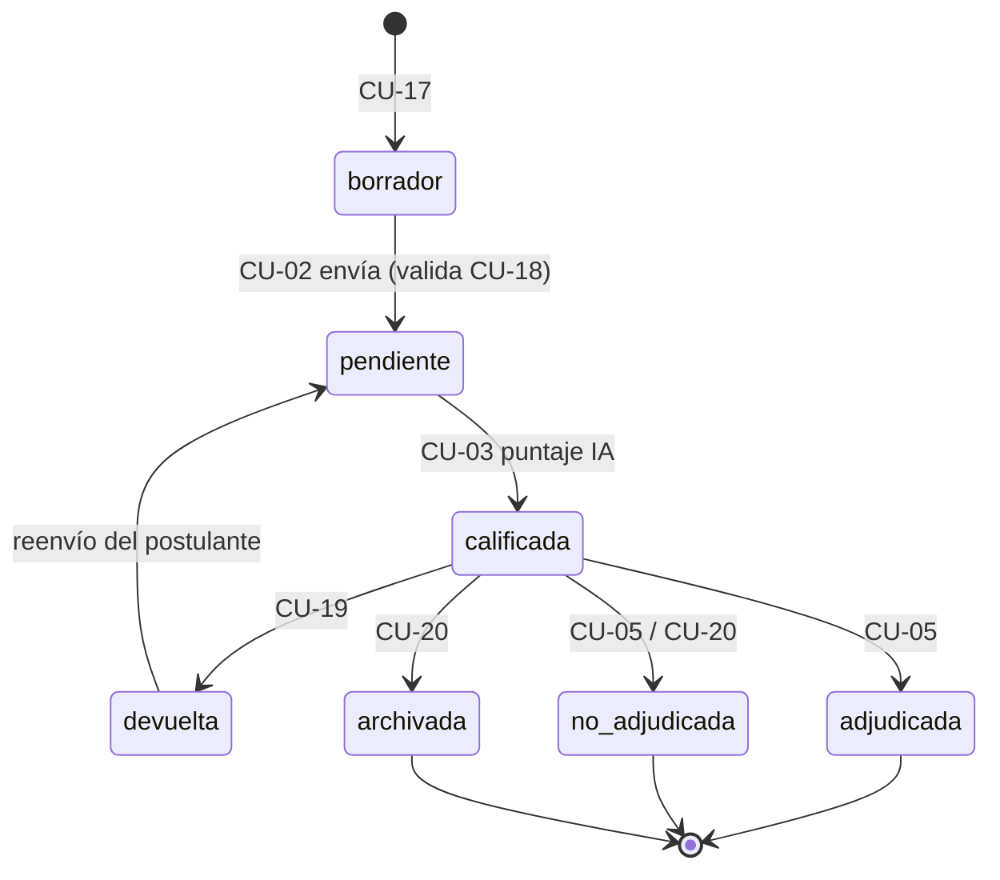

# Diseño de base de datos — Beca Comedor (DUBSS–UAGRM)

Propuesta de modelo relacional (**PostgreSQL**) derivada de los 26 CU vigentes ([`casos_de_uso_filtrados.md`](casos_de_uso_filtrados.md)), los 21 RF ([`03_requisitos_especificos.tex`](secciones/05_capitulo4_ieee830/03_requisitos_especificos.tex)) y el modelo de dominio (CLAUDE.md §3).

> **Borrador para revisión.** No está en `secciones/`. Los datos institucionales no confirmados se marcan **[por definir con la DUBSS]**. Sirve de insumo para el diagrama de clases/ER del Cap. 7 (Diseño) y para las migraciones del backend (Spring Boot).

---

## 1. Criterios de diseño

| Criterio | Decisión |
|---|---|
| Organización | Un esquema lógico por paquete de análisis (P1…P6), mismo agrupamiento de 6.1.1. Se pueden implementar como esquemas PostgreSQL (`cuentas`, `postulacion`, `ia`, `adjudicacion`, `becados`, `reportes`) o como prefijos. |
| Nombres | `snake_case`, singular, en español. PK `id` (`bigint generated always as identity`). FK `<tabla>_id`. |
| Autenticación | La contraseña **no** se guarda en PostgreSQL: la gestiona **Firebase Auth**. Se guarda `firebase_uid` para enlazar. |
| Archivos | Los binarios van en **Firebase Storage**; la BD guarda solo la ruta (`storage_path`), tipo y tamaño. |
| Unicidad | `usuario.ci` y `usuario.correo` únicos. Una sola postulación por (postulante, convocatoria). |
| Trazabilidad | Todo cambio de estado de postulación y toda acción relevante deja fila en `postulacion_historial` y `bitacora` (append-only). El puntaje se guarda con fecha de cálculo y los puntajes antiguos se conservan. |
| Idempotencia (RNF-03) | `UNIQUE (beca_id, fecha)` en `asistencia`; `UNIQUE (postulante_id, convocatoria_id)` en `postulacion`. Reintentos de la misma petición no duplican filas. |
| Volumen | ~20,000 postulaciones/gestión → índices sobre `(convocatoria_id, estado)` y sobre el puntaje vigente (ver §5). |
| Auditoría de filas | Tablas transaccionales con `creado_en` y `actualizado_en` (`timestamptz`). |

---

## 2. Vista general (entidades y relaciones)



---

## 3. Modelo por paquete

Convenciones: **PK** clave primaria · **FK** clave foránea · **UQ** único · **NN** no nulo · `*` columna obligatoria.

### P1 — Cuentas y acceso (CU-01, CU-14, CU-15)

```mermaid
erDiagram
    ROL ||--o{ USUARIO : "tiene"
    USUARIO ||--o| POSTULANTE : "es"
    CARRERA ||--o{ POSTULANTE : "cursa"
    ROL { bigint id PK
          varchar nombre UQ }
    USUARIO { bigint id PK
              varchar firebase_uid UQ
              varchar ci UQ
              varchar correo UQ
              varchar nombres
              varchar apellidos
              bigint rol_id FK
              boolean activo }
    POSTULANTE { bigint usuario_id PK
                 bigint carrera_id FK
                 varchar registro_universitario
                 varchar telefono }
    CARRERA { bigint id PK
              varchar nombre UQ
              varchar facultad }
```

**`rol`** — catálogo fijo: `POSTULANTE`, `ADMINISTRADOR_DUBSS`, `DIRECTIVO`, `PERSONAL_COMEDOR`. («Usuario del Sistema» es abstracto y no se almacena; «Becado» no es rol: es un `postulante` con `beca` vigente.)

**`usuario`**

| Columna | Tipo | Restricciones | Nota |
|---|---|---|---|
| id | bigint | PK | |
| firebase_uid | varchar(128) | UQ, NN | enlace con Firebase Auth (CU-01) |
| ci | varchar(20) | UQ, NN | RN: CI único |
| correo | varchar(150) | UQ, NN | RN: correo único |
| nombres, apellidos | varchar(100) | NN | |
| rol_id | bigint | FK→rol, NN | CU-14: asignación de rol |
| activo | boolean | NN, default true | CU-14: desactivar sin borrar |
| creado_en, actualizado_en | timestamptz | NN | |

**`postulante`** (extensión 1:1 de `usuario` solo para rol POSTULANTE)

| Columna | Tipo | Restricciones | Nota |
|---|---|---|---|
| usuario_id | bigint | PK, FK→usuario | |
| carrera_id | bigint | FK→carrera, NN | perfil UAGRM |
| registro_universitario | varchar(20) | UQ | **[formato por definir]** |
| telefono | varchar(20) | | datos de contacto (CU-15) |

**`carrera`**: `id`, `nombre` (UQ), `facultad`. Catálogo poblado desde el padrón/perfil UAGRM **[fuente por definir con la DUBSS]**.

> CU-15 (recuperar contraseña) lo resuelve Firebase; en BD solo se actualizan `telefono`/`correo`. El CI no es modificable (RF-10): se controla en la capa de servicio (opcional: trigger que rechace `UPDATE` de `ci`).

---

### P2 — Convocatoria y postulación (CU-13, CU-02, CU-16, CU-17, CU-18, CU-04)

```mermaid
erDiagram
    GESTION_ACADEMICA ||--o{ CONVOCATORIA : "contiene"
    CONVOCATORIA ||--o{ CONVOCATORIA_DOCUMENTO : "exige"
    TIPO_DOCUMENTO ||--o{ CONVOCATORIA_DOCUMENTO : "define"
    POSTULANTE ||--o{ POSTULACION : "envia"
    CONVOCATORIA ||--o{ POSTULACION : "recibe"
    POSTULACION ||--|| RESPUESTA_SOCIOECONOMICA : "declara"
    POSTULACION ||--o{ NOTA_ACADEMICA : "registra"
    POSTULACION ||--o{ DOCUMENTO_ADJUNTO : "adjunta"
    TIPO_DOCUMENTO ||--o{ DOCUMENTO_ADJUNTO : "clasifica"
    POSTULACION ||--o{ POSTULACION_HISTORIAL : "historial"
    GESTION_ACADEMICA { bigint id PK
                        varchar etiqueta UQ }
    CONVOCATORIA { bigint id PK
                   bigint gestion_id FK
                   timestamptz fecha_apertura
                   timestamptz fecha_cierre
                   int cupos
                   varchar estado }
    POSTULACION { bigint id PK
                  bigint postulante_id FK
                  bigint convocatoria_id FK
                  varchar estado
                  timestamptz fecha_envio }
    RESPUESTA_SOCIOECONOMICA { bigint postulacion_id PK
                               numeric ingresos_familiares
                               int dependientes
                               varchar procedencia }
    DOCUMENTO_ADJUNTO { bigint id PK
                        bigint postulacion_id FK
                        bigint tipo_documento_id FK
                        varchar storage_path }
```

**`gestion_academica`**: `id`, `etiqueta` (UQ, p. ej. «2026-II» **[formato por definir]**), `fecha_inicio`, `fecha_fin`.

**`convocatoria`** (CU-13)

| Columna | Tipo | Restricciones | Nota |
|---|---|---|---|
| id | bigint | PK | |
| gestion_id | bigint | FK→gestion_academica, NN | |
| nombre | varchar(150) | NN | |
| fecha_apertura / fecha_cierre | timestamptz | NN, CHECK (cierre > apertura) | el sistema solo recibe envíos con convocatoria `ABIERTA` |
| cupos | int | CHECK (cupos > 0) | **[número por definir; ~900 según presupuesto]** |
| puntaje_minimo | numeric(5,2) | CHECK (0–100) | umbral de adjudicación **[por definir con la DUBSS]** |
| estado | enum `estado_convocatoria` | NN | `BORRADOR`, `ABIERTA`, `CERRADA` |
| creado_por | bigint | FK→usuario | |

Regla: **una sola convocatoria vigente por gestión** → índice único parcial `UNIQUE (gestion_id) WHERE estado = 'ABIERTA'`.

**`tipo_documento`** (catálogo): `id`, `nombre`, `descripcion`. Valores **[por definir con la DUBSS]** (p. ej. carnet, certificado de ingresos…).
**`convocatoria_documento`** (N:M): `convocatoria_id`, `tipo_documento_id`, `obligatorio` (boolean) — PK compuesta. Implementa «documentos requeridos por convocatoria» (RF-08).

**`postulacion`** (CU-02, CU-17, CU-04)

| Columna | Tipo | Restricciones | Nota |
|---|---|---|---|
| id | bigint | PK | |
| postulante_id | bigint | FK→postulante, NN | |
| convocatoria_id | bigint | FK→convocatoria, NN | |
| estado | enum `estado_postulacion` | NN | ver §4 |
| fecha_envio | timestamptz | NULL mientras sea borrador | |
| numero_envios | smallint | NN, default 0 | se incrementa en cada reenvío tras *devuelta* |
| creado_en, actualizado_en | timestamptz | NN | |

- `UNIQUE (postulante_id, convocatoria_id)` → implementa CU-18 (duplicados) y la regla «una postulación por postulante y gestión». Una postulación *devuelta* **se reenvía sobre la misma fila** (no se crea otra); el detalle queda en `postulacion_historial`.
- CU-17 (borrador): estado `borrador` (ver pregunta abierta Q1). Un borrador no se envía al módulo IA.

**`respuesta_socioeconomica`** (1:1 con postulación; formulario del CU-02)

| Columna | Tipo | Nota |
|---|---|---|
| postulacion_id | bigint PK/FK | |
| ingresos_familiares | numeric(12,2) | |
| dependientes | smallint | |
| procedencia | varchar(150) | |
| patrimonio | varchar(255) | descripción o categoría **[por definir]** |
| estado_vulnerabilidad | varchar(50) | categoría declarada **[catálogo por definir]** |
| promedio_academico | numeric(5,2) | CHECK (0–100) **[escala por definir]** |
| datos_extra | jsonb | variables adicionales sin migrar el esquema |

**`nota_academica`** (entidad del modelo de dominio): `id`, `postulacion_id` FK, `periodo`, `promedio`. `UNIQUE (postulacion_id, periodo)`.

**`documento_adjunto`** (CU-16)

| Columna | Tipo | Restricciones | Nota |
|---|---|---|---|
| id | bigint | PK | |
| postulacion_id | bigint | FK, NN | |
| tipo_documento_id | bigint | FK, NN | |
| nombre_archivo | varchar(255) | NN | |
| storage_path | varchar(500) | NN | ruta en Firebase Storage |
| mime_type | varchar(100) | NN | formatos permitidos **[por definir]** |
| tamano_bytes | bigint | CHECK (> 0) | tamaño máximo **[por definir]** |
| subido_en | timestamptz | NN | |

**`postulacion_historial`** (CU-02, CU-19, CU-20, CU-05; base del estado visible en CU-04)

| Columna | Tipo | Nota |
|---|---|---|
| id | bigint PK | |
| postulacion_id | bigint FK, NN | |
| estado_anterior / estado_nuevo | `estado_postulacion` | |
| usuario_id | bigint FK→usuario | quién cambió el estado (NULL si fue el sistema) |
| motivo | text | obligatorio al devolver, archivar o rechazar (CHECK en servicio) |
| creado_en | timestamptz NN | |

---

### P3 — Preselección con IA (CU-03, CU-26)

```mermaid
erDiagram
    MODELO_PRESELECCION ||--o{ PARAMETRO_MODELO : "tiene"
    MODELO_PRESELECCION ||--o{ PUNTAJE_POSTULACION : "genera"
    POSTULACION ||--o{ PUNTAJE_POSTULACION : "obtiene"
    CONVOCATORIA ||--o{ LOTE_REPROCESAMIENTO : "reprocesa"
    MODELO_PRESELECCION ||--o{ LOTE_REPROCESAMIENTO : "usa"
    MODELO_PRESELECCION { bigint id PK
                          varchar version UQ
                          boolean activo }
    PARAMETRO_MODELO { bigint id PK
                       bigint modelo_id FK
                       varchar clave
                       numeric ponderacion }
    PUNTAJE_POSTULACION { bigint id PK
                          bigint postulacion_id FK
                          bigint modelo_id FK
                          numeric puntaje_total
                          timestamptz fecha_calculo
                          boolean vigente }
    LOTE_REPROCESAMIENTO { bigint id PK
                           bigint convocatoria_id FK
                           bigint modelo_id FK
                           varchar estado }
```

**`modelo_preseleccion`**: `id`, `version` (UQ), `descripcion`, `activo` (boolean; solo uno `true` → índice único parcial), `creado_por`, `creado_en`.
**`parametro_modelo`** (CU-26): `id`, `modelo_id` FK, `clave`, `ponderacion` numeric, `valor` jsonb. `UNIQUE (modelo_id, clave)`. Contenido **[criterios y ponderaciones por definir con la DUBSS]**.

**`puntaje_postulacion`** (CU-03) — **historial de puntajes** (RF-03, RF-21: se conserva el anterior)

| Columna | Tipo | Restricciones | Nota |
|---|---|---|---|
| id | bigint | PK | |
| postulacion_id | bigint | FK, NN | |
| modelo_id | bigint | FK, NN | versión que lo calculó |
| puntaje_total | numeric(5,2) | CHECK (0–100) | |
| detalle | jsonb | | desglose por variable (explicabilidad ante auditoría) |
| fecha_calculo | timestamptz | NN | trazabilidad |
| vigente | boolean | NN | solo un `true` por postulación → `UNIQUE (postulacion_id) WHERE vigente` |

> El modelo de dominio menciona *revisión documental 1–70 + rendimiento 30*; al descartarse esos CU, el puntaje lo calcula la IA. Si se recuperara la calificación manual, añadir `puntaje_documental` y `puntaje_academico` (ver Q3).

**`lote_reprocesamiento`** (CU-26): `id`, `convocatoria_id` FK, `modelo_id` FK, `solicitado_por` FK→usuario, `estado` (`PENDIENTE`, `EN_PROCESO`, `COMPLETADO`, `FALLIDO`), `total_postulaciones`, `iniciado_en`, `terminado_en`. El procesamiento masivo es **en lote** (no bloquea el envío; el puntaje individual debe estar en ≤ 5 s, RNF-03).

---

### P4 — Auditoría y adjudicación (CU-05…08, CU-19…22)



**Lista priorizada (CU-06):** no se almacena como tabla; es una consulta ordenada por `puntaje_postulacion.puntaje_total` (vigente) de las postulaciones `calificada` de la convocatoria, paginada. Se apoya en el índice del §5.

**`finalista`** (CU-05/07/21)

| Columna | Tipo | Restricciones | Nota |
|---|---|---|---|
| id | bigint | PK | |
| postulacion_id | bigint | FK, UQ, NN | |
| posicion | int | | lugar en la lista priorizada al momento de seleccionar |
| notificado_en | timestamptz | | push enviado (CU-21) |
| plazo_entrega | date | | **[plazo por definir con la DUBSS]** |
| documentacion_recibida_en | timestamptz | | CU-21: registro de entrega física |

**`auditoria_expediente`** (CU-07): `id`, `finalista_id` FK, `auditor_id` FK→usuario, `resultado` (`VALIDADO`, `OBSERVADO`, `NO_VALIDO`), `observaciones` text, `fecha_auditoria`. Una finalista puede tener varias auditorías (p. ej. tras una devolución).
> Devolver (CU-19) y archivar/rechazar (CU-20) **no tienen tabla propia**: son transiciones de estado registradas en `postulacion_historial` con su `motivo`.

**`adjudicacion`** (CU-05; resultado por postulación)

| Columna | Tipo | Restricciones | Nota |
|---|---|---|---|
| id | bigint | PK | |
| postulacion_id | bigint | FK, UQ, NN | |
| resultado | enum | NN | `ADJUDICADA`, `NO_ADJUDICADA` |
| puntaje_final | numeric(5,2) | | copia del puntaje vigente al decidir (inmutable) |
| decidido_por | bigint | FK→usuario, NN | |
| fecha_adjudicacion | timestamptz | NN | entidad `BecaComedor.fecha de adjudicación` del dominio |

**`acta_adjudicacion`** (CU-08, **pendiente de consulta**): `id`, `convocatoria_id` FK, `numero` (UQ), `storage_path` (PDF), `generada_por`, `generada_en`.
**`publicacion_resultado`** (CU-22): `id`, `convocatoria_id` FK (UQ), `publicado_por`, `publicado_en`. Una vez insertada, `adjudicacion` de esa convocatoria deja de ser editable (control en servicio + bitácora).

**`comunicado`** (CU-21, fusionado con avisos): `id`, `convocatoria_id` FK (nullable), `titulo`, `contenido` text, `destinatarios` (`TODOS`, `FINALISTAS`, `ADJUDICADOS`), `publicado_por`, `publicado_en`.

**`notificacion`** (CU-04, CU-19, CU-21, CU-22; Firebase FCM)

| Columna | Tipo | Nota |
|---|---|---|
| id | bigint PK | |
| usuario_id | bigint FK, NN | destinatario |
| tipo | enum | `CAMBIO_ESTADO`, `FINALISTA`, `COMUNICADO`, `RESULTADO` |
| titulo, mensaje | varchar / text | |
| postulacion_id / comunicado_id | bigint FK, nullable | referencia de contexto |
| leida | boolean NN default false | consultable desde la app |
| enviada_en | timestamptz | NULL si falló el push |
| creado_en | timestamptz NN | |

**`dispositivo_fcm`**: `id`, `usuario_id` FK, `token` (UQ), `plataforma` (`ANDROID`, `IOS`, `WEB`), `actualizado_en`.

---

### P5 — Becados y asistencia (CU-23, CU-09, CU-10, CU-11, CU-24)



**`beca`** (entidad `BecaComedor` del dominio; CU-23)

| Columna | Tipo | Restricciones | Nota |
|---|---|---|---|
| id | bigint | PK | |
| adjudicacion_id | bigint | FK, UQ, NN | solo adjudicaciones con resultado `ADJUDICADA` |
| postulante_id | bigint | FK, NN | desnormalizado para consultas del becado (CU-24) |
| convocatoria_id | bigint | FK, NN | |
| estado | enum `estado_beca` | NN | `VIGENTE`, `SUSPENDIDA`, `BAJA` |
| fecha_inicio / fecha_fin | date | | |

**`movimiento_beca`** (CU-23: baja, suspensión, reemplazo): `id`, `beca_id` FK, `tipo` (`BAJA`, `SUSPENSION`, `REACTIVACION`, `REEMPLAZO`), `motivo` text NN, `beca_reemplazante_id` FK→beca (solo en `REEMPLAZO`: la beca que ocupa el cupo liberado), `registrado_por` FK→usuario, `fecha`. El **padrón vigente** es `beca WHERE estado = 'VIGENTE'`.

**`planilla_asistencia`** (CU-09): `id`, `convocatoria_id` FK, `fecha_desde`, `fecha_hasta`, `storage_path` (PDF imprimible con espacio de firma y fotocopia de carnet), `generada_por`, `generada_en`. Se genera a partir del padrón vigente en ese momento.

**`asistencia`** (CU-10, CU-24)

| Columna | Tipo | Restricciones | Nota |
|---|---|---|---|
| id | bigint | PK | |
| beca_id | bigint | FK, NN | |
| fecha | date | NN | |
| hora_registro | timestamptz | NN | |
| registrado_por | bigint | FK→usuario (rol PERSONAL_COMEDOR) | |
| **UQ (beca_id, fecha)** | | | idempotencia (RNF-03) y un registro por día |

> El sistema **no** tiene biometría (CLAUDE.md §3): `asistencia` solo almacena el resultado de la verificación hecha por el comedor.

**`cotejo_asistencia`** (CU-11, extiende CU-10; **pendiente de consulta**): `id`, `planilla_id` FK, `realizado_por` FK→usuario, `fecha_cotejo`, `total_registros`, `coincidencias`, `discrepancias`, `observaciones` text, `resultado` (`CONFORME`, `CON_DISCREPANCIAS`).
Opcional `cotejo_detalle` (`cotejo_id`, `asistencia_id`, `firmado_en_planilla` boolean, `observacion`) si se requiere trazar fila por fila.

---

### P6 — Reportes y trazabilidad (CU-12, CU-25)

**`bitacora`** (CU-25) — *append-only*

| Columna | Tipo | Nota |
|---|---|---|
| id | bigint PK | |
| usuario_id | bigint FK→usuario | NULL si la acción es del sistema/IA |
| accion | varchar(60) NN | `AUDITAR`, `DEVOLVER`, `ADJUDICAR`, `CAMBIAR_ROL`, `BAJA_BECA`, `PUBLICAR`… |
| entidad | varchar(60) NN | tabla afectada |
| entidad_id | bigint | |
| detalle | jsonb | valores antes/después |
| ip | inet | |
| creado_en | timestamptz NN | |

Sin `UPDATE`/`DELETE` para el rol de la aplicación (`REVOKE UPDATE, DELETE ON bitacora FROM app_user`). Índices: `(usuario_id, creado_en)`, `(accion, creado_en)`.

**BI (CU-12):** sin tablas transaccionales nuevas. Se alimenta de **vistas materializadas** refrescadas en lote (RNF: BI en lote), p. ej. `mv_indicadores_convocatoria` (postulaciones recibidas, finalistas, adjudicadas, tasa de asistencia por convocatoria y mes), filtrables por gestión académica. Si el volumen lo exige, pasar a un esquema `reportes` con tablas de hechos agregadas.

---

## 4. Enumeraciones

| Enum | Valores | Observación |
|---|---|---|
| `estado_postulacion` | `borrador`*, `pendiente`, `devuelta`, `archivada`, `calificada`, `adjudicada`, `no_adjudicada` | Los seis últimos vienen del modelo de dominio. `*borrador` es adición por CU-17 (Q1). RF-06 usa otra nomenclatura (recibida, en evaluación, finalista…): **unificar** (Q2). |
| `estado_convocatoria` | `BORRADOR`, `ABIERTA`, `CERRADA` | |
| `estado_beca` | `VIGENTE`, `SUSPENDIDA`, `BAJA` | RF-19 |
| `resultado_adjudicacion` | `ADJUDICADA`, `NO_ADJUDICADA` | |
| `tipo_movimiento_beca` | `BAJA`, `SUSPENSION`, `REACTIVACION`, `REEMPLAZO` | |
| `destinatarios_comunicado` | `TODOS`, `FINALISTAS`, `ADJUDICADOS` | |

**Ciclo de vida de `postulacion.estado`**



---

## 5. Índices y reglas de integridad críticas

| Objetivo | Definición |
|---|---|
| Una postulación por postulante y convocatoria | `UNIQUE (postulante_id, convocatoria_id)` en `postulacion` |
| Una convocatoria abierta por gestión | `CREATE UNIQUE INDEX ... ON convocatoria (gestion_id) WHERE estado = 'ABIERTA'` |
| Lista priorizada rápida (CU-06) | `puntaje_postulacion (puntaje_total DESC) WHERE vigente` + `postulacion (convocatoria_id, estado)` |
| Un puntaje vigente por postulación | `UNIQUE (postulacion_id) WHERE vigente` |
| Un modelo activo | `UNIQUE (activo) WHERE activo` en `modelo_preseleccion` |
| Asistencia idempotente | `UNIQUE (beca_id, fecha)` |
| Padrón vigente | `beca (convocatoria_id, estado)` |
| Búsqueda de usuarios | `usuario (ci)`, `usuario (correo)` (ya únicos) |
| Notificaciones no leídas | `notificacion (usuario_id, leida, creado_en DESC)` |
| Reglas de negocio en BD | `CHECK` de rangos (puntajes 0–100, fechas, cupos > 0). Las reglas con estados (p. ej. «publicar solo si todas las adjudicaciones están decididas», «motivo obligatorio al archivar») se validan en la capa de servicio con transacción. |
| Integridad referencial | `ON DELETE RESTRICT` en general; no se borran postulaciones ni usuarios (se archivan / desactivan). `ON DELETE CASCADE` solo para `documento_adjunto` y `respuesta_socioeconomica` al eliminar un **borrador**. |

---

## 6. Trazabilidad CU → tablas

| CU | Caso de uso | Tablas principales |
|---|---|---|
| CU-01 | Registrarse y autenticarse | `usuario`, `rol`, `postulante`, `carrera` |
| CU-02 | Enviar postulación | `postulacion`, `respuesta_socioeconomica`, `nota_academica`, `postulacion_historial` |
| CU-03 | Precalificar con IA | `puntaje_postulacion`, `modelo_preseleccion` |
| CU-04 | Consultar estado | `postulacion`, `postulacion_historial`, `notificacion` |
| CU-05 | Auditar y adjudicar becas | `adjudicacion`, `finalista`, `postulacion` |
| CU-06 | Lista priorizada | `puntaje_postulacion` + `postulacion` (consulta) |
| CU-07 | Auditar expediente finalista | `finalista`, `auditoria_expediente`, `documento_adjunto` |
| CU-08 | Acta de adjudicación | `acta_adjudicacion`, `adjudicacion` |
| CU-09 | Planilla de asistencia | `planilla_asistencia`, `beca` |
| CU-10 | Registrar asistencia digital | `asistencia`, `beca` |
| CU-11 | Cotejar contra respaldo físico | `cotejo_asistencia`, `planilla_asistencia`, `asistencia` |
| CU-12 | Dashboard BI | vistas materializadas sobre `postulacion`, `adjudicacion`, `asistencia`, `beca` |
| CU-13 | Convocatoria y gestión | `gestion_academica`, `convocatoria`, `convocatoria_documento`, `tipo_documento` |
| CU-14 | Usuarios y roles | `usuario`, `rol`, `bitacora` |
| CU-15 | Recuperar contraseña / perfil | `usuario`, `postulante` (contraseña en Firebase) |
| CU-16 | Digitalizar y adjuntar documentos | `documento_adjunto`, `tipo_documento` |
| CU-17 | Guardar borrador | `postulacion` (estado `borrador`), `respuesta_socioeconomica`, `documento_adjunto` |
| CU-18 | Validar elegibilidad y duplicados | `UNIQUE` en `postulacion`, `postulante`, `convocatoria` |
| CU-19 | Devolver para corrección | `postulacion_historial`, `postulacion`, `notificacion` |
| CU-20 | Archivar o rechazar | `postulacion_historial`, `postulacion` |
| CU-21 | Notificar finalistas / comunicados | `finalista`, `comunicado`, `notificacion`, `dispositivo_fcm` |
| CU-22 | Publicar resultados | `publicacion_resultado`, `adjudicacion`, `notificacion` |
| CU-23 | Padrón de becados | `beca`, `movimiento_beca` |
| CU-24 | Historial de asistencia y beca | `asistencia`, `beca`, `movimiento_beca` |
| CU-25 | Bitácora | `bitacora` |
| CU-26 | Parametrizar y reprocesar | `parametro_modelo`, `modelo_preseleccion`, `lote_reprocesamiento`, `puntaje_postulacion` |

Cobertura: los 26 CU tienen al menos una tabla; los CU del P4 de cierre de expediente (CU-19/20) se resuelven con `postulacion_historial`.

---

## 7. Resumen

**31 tablas** (4 son catálogos: `rol`, `carrera`, `tipo_documento`, `gestion_academica`), más 1 opcional (`cotejo_detalle`) y las vistas materializadas de BI:

| Paquete | Tablas |
|---|---|
| P1 Cuentas y acceso (4) | `rol`, `usuario`, `postulante`, `carrera` |
| P2 Convocatoria y postulación (9) | `gestion_academica`, `convocatoria`, `tipo_documento`, `convocatoria_documento`, `postulacion`, `respuesta_socioeconomica`, `nota_academica`, `documento_adjunto`, `postulacion_historial` |
| P3 Preselección con IA (4) | `modelo_preseleccion`, `parametro_modelo`, `puntaje_postulacion`, `lote_reprocesamiento` |
| P4 Auditoría y adjudicación (8) | `finalista`, `auditoria_expediente`, `adjudicacion`, `acta_adjudicacion`, `publicacion_resultado`, `comunicado`, `notificacion`, `dispositivo_fcm` |
| P5 Becados y asistencia (5, +1 opcional) | `beca`, `movimiento_beca`, `planilla_asistencia`, `asistencia`, `cotejo_asistencia` (+ `cotejo_detalle`) |
| P6 Reportes y trazabilidad (1) | `bitacora` (+ vistas materializadas de BI) |

---

## 8. Preguntas abiertas (consultar con la DUBSS / docente)

| # | Pregunta | Impacto en el modelo |
|---|---|---|
| Q1 | ¿El borrador (CU-17, *observado*) se modela como estado `borrador` o como tabla aparte? | Si se descarta CU-17: quitar `borrador`, `ON DELETE CASCADE` y `fecha_envio` nullable. |
| Q2 | Unificar estados de `Postulacion` (dominio vs. RF-06: recibida, en evaluación, finalista…). ¿«Finalista» es un estado o solo la fila en `finalista`? | Cambia el enum y las transiciones; hoy «finalista» es una tabla, no un estado. |
| Q3 | ¿Se recupera el puntaje 1–70 documental + 30 académico del dominio, o todo lo calcula la IA? | Añadir `puntaje_documental`, `puntaje_academico` y una tabla de calificación por documento. |
| Q4 | Umbral mínimo de puntaje y número exacto de cupos. | `convocatoria.puntaje_minimo`, `cupos` quedan sin valor por defecto. |
| Q5 | ¿Se mantiene CU-08 (acta) y CU-11 (cotejo), pendientes de consulta? | Eliminar `acta_adjudicacion` y/o `cotejo_asistencia` / `cotejo_detalle`. |
| Q6 | Apelación/reclamo del postulante (no figura en ningún capítulo). | Tabla `apelacion` (postulacion_id, motivo, estado, resolución) si se acepta. |
| Q7 | Formatos, tamaño máximo y lista de documentos requeridos; catálogos de patrimonio y vulnerabilidad; formato de gestión y de registro universitario. | Contenido de `tipo_documento`, `CHECK` de `documento_adjunto`, catálogos. |
| Q8 | ¿Un usuario puede tener más de un rol? | Hoy 1:N (`usuario.rol_id`). Si sí: tabla `usuario_rol` N:M. |
| Q9 | Historial entre gestiones: ¿un becado se **renueva** cada gestión o postula de nuevo? | Hoy cada gestión genera una `postulacion` y una `beca` nuevas; una renovación requeriría `beca.beca_anterior_id`. |
